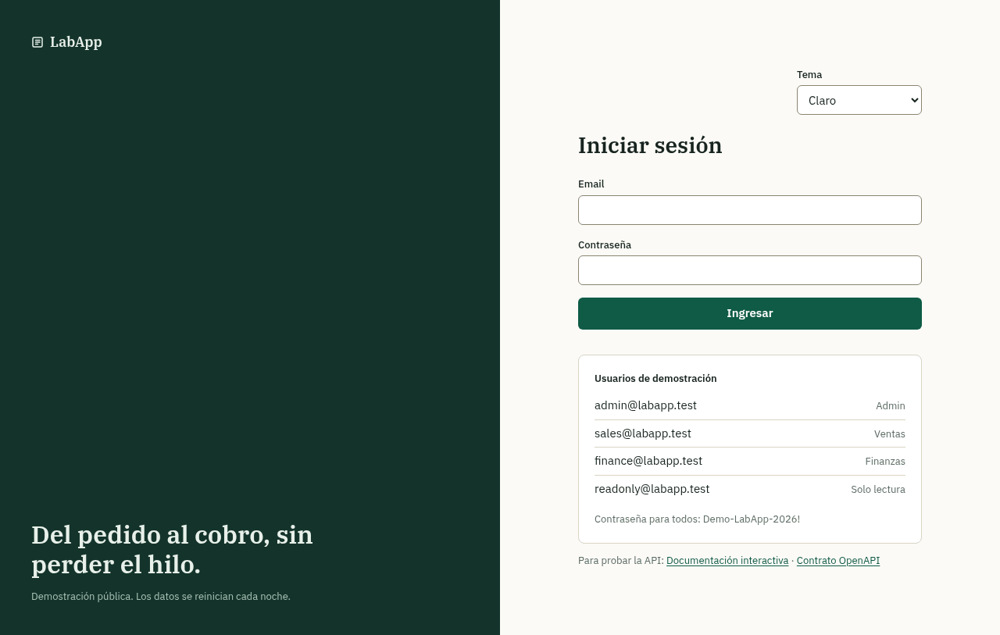
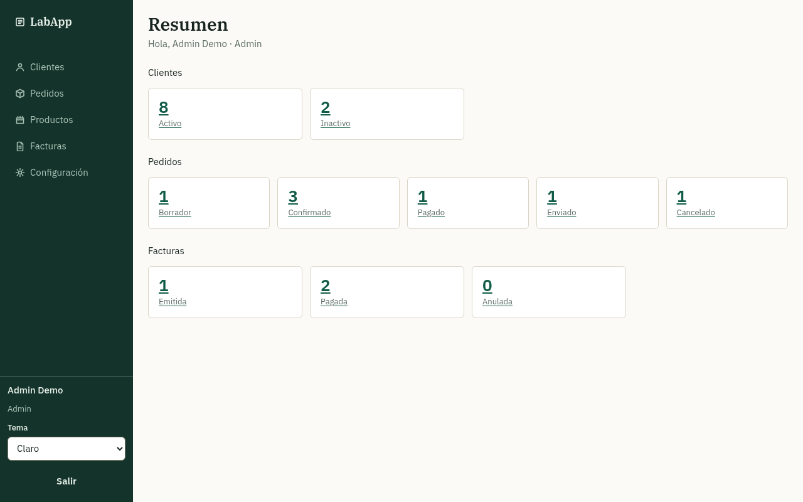
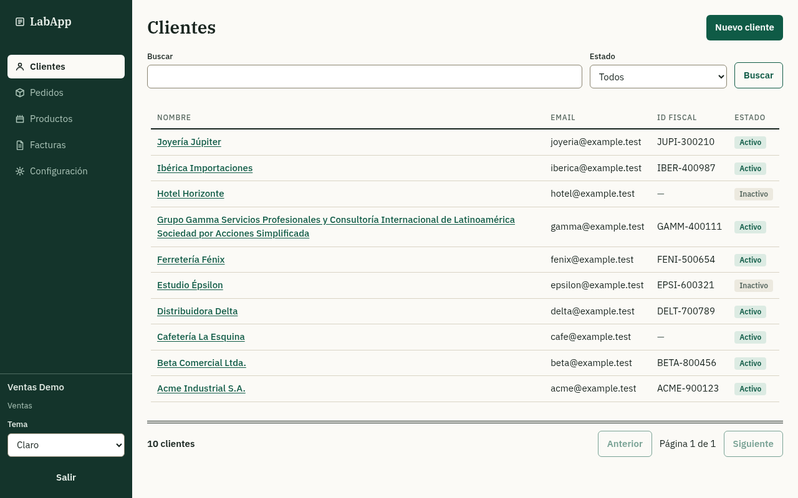
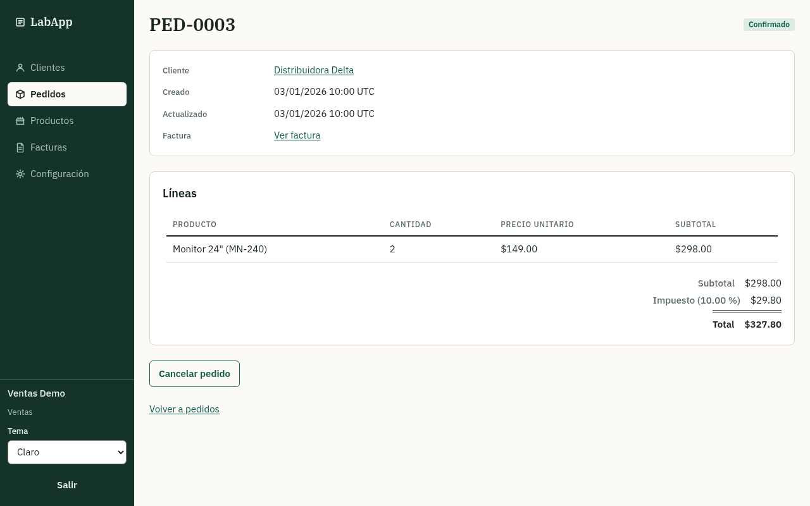
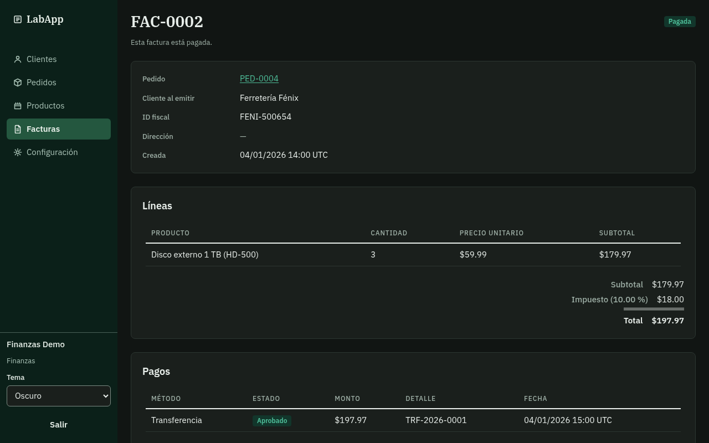
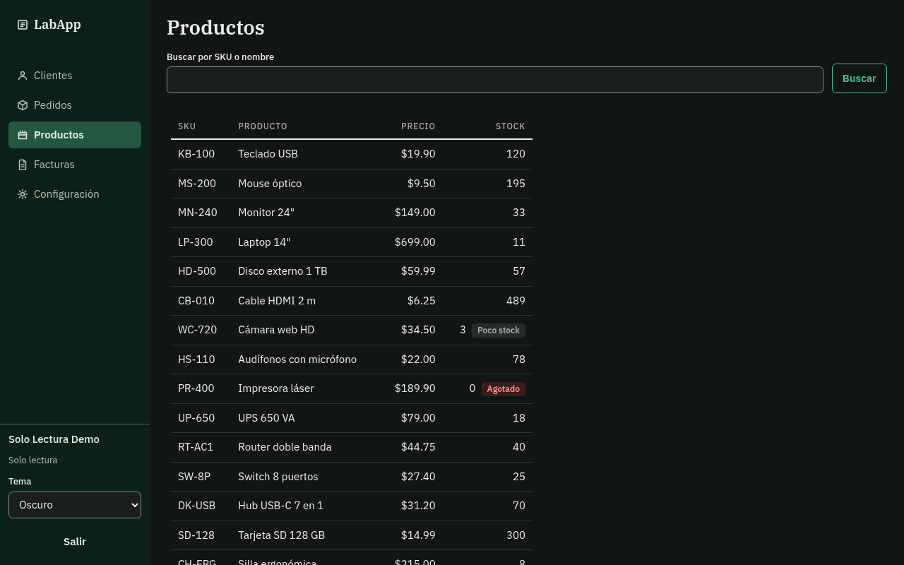
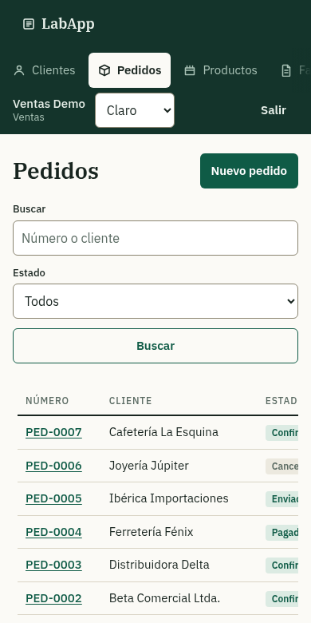

# LabApp

Un ERP pequeño de pedido a cobro (clientes, pedidos, facturas, pagos) hecho para ser el blanco ideal de la automatización de pruebas: un `data-testid` estable en cada elemento interactivo, HTML accesible, datos deterministas y controles solo para pruebas que reinician datos, mueven el reloj e inyectan fallas.

> English version: [README.md](README.md)

**Estado:** en desarrollo activo, aún sin desplegar. Lo que existe hoy está en "Dónde va"; la especificación, la arquitectura y el contrato de testabilidad están escritos y se mantienen al día con el código.

## Capturas

Tomadas de una compilación de producción con los datos de ejemplo, en las dos versiones del diseño "Libro mayor" y en ancho de teléfono.

<p>
  
  
  
  
  
  
</p>



## Por qué

Las apps demo públicas para automatización suelen traer elementos sin localizadores fiables, lo que obliga a usar selectores frágiles. LabApp está pensada al revés: la testabilidad es un contrato (ver [docs/TESTABILITY.md](docs/TESTABILITY.md)), que se exige con tipos, reglas de lint y dos auditorías que corren en CI (una estática y otra en navegador con axe).

## Qué hace

Tres flujos principales, que se pulen antes de añadir módulos nuevos: crear un cliente; armar y confirmar un pedido; facturar el pedido y registrar el pago.

Aparte de esos tres flujos, hoy la aplicación:

- trae los cuatro roles (Admin, Ventas, Finanzas y Solo lectura) con usuarios de ejemplo sembrados, uno por rol,
- guarda el estado de las cuatro pantallas de lista en la URL (página, búsqueda, filtro de estado y orden por encabezado, ordenado contra la API),
- exporta clientes, pedidos y facturas a CSV (un enlace de descarga que respeta los filtros aplicados) e importa clientes desde un archivo CSV (todo o nada, con los errores listados fila por fila),
- expone controles solo para pruebas — reset, seed, un reloj que se mueve e inyección de fallas — protegidos con token fuera del modo de prueba,
- registra pagos idempotentes contra una pasarela falsa (la tarjeta aprobada, la rechazada y la de pasarela caída),
- publica el contrato OpenAPI (`GET /api/openapi.json`, comprobado contra el código en CI; la copia del repositorio está en [docs/openapi.json](docs/openapi.json)) y una interfaz Swagger en `/api/docs`,
- ofrece el diseño "Libro mayor" en versión clara y oscura (sigue al sistema y se recuerda por navegador), y
- se ve en español.

Las reglas de negocio están en [docs/SPEC.md](docs/SPEC.md) (en inglés).

## Tecnologías

| Capa | Elección |
|---|---|
| Backend | FastAPI (Python), SQLAlchemy 2, Alembic, PostgreSQL |
| Frontend | Next.js, TypeScript, Tailwind, TanStack Query y Table |
| Contrato | OpenAPI generado por el backend y cliente tipado generado para el frontend |
| Local | Un script de arranque (`mise run dev`), datos en memoria o una base Neon de desarrollo, pasarela de pagos falsa; el correo falso solo se escribe en los logs |
| Demo en línea | Vercel (web y API en un solo proyecto), Neon (Postgres), todo en capas gratuitas |

## Dónde va

| Área | Estado |
|---|---|
| Login, sesiones y los cuatro roles | Hecho (en memoria y en PostgreSQL) |
| Clientes: API, pantallas, almacén en PostgreSQL, exportación y importación CSV | Hecho |
| Pedidos: API, pantallas, almacén en PostgreSQL con stock y numeración bajo concurrencia | Hecho |
| Facturas y pagos: API, pantallas, almacén en PostgreSQL con pagos idempotentes y pasarela falsa | Hecho |
| Página de productos, Configuración (impuesto, solo Admin), resumen de inicio, diálogos de confirmación, páginas 404 y de error | Hecho |
| Diseño: tema "Libro mayor" en versión clara y oscura, selector que se recuerda por navegador | Hecho |
| Ordenación en las cuatro listas: encabezados con `aria-sort` y un texto que anuncia el orden, que viaja al CSV y se aplica antes de paginar | Hecho |
| Auditoría de teclado en la auditoría de navegador (foco siempre visible, sin trampas de foco, todo elemento tabulable alcanzado) | Hecho |
| Auditorías de reflujo a 320 px (doce estados, sin desplazamiento lateral; las tablas solo se mueven dentro de su región) más ancho de teléfono y tablet, en los dos temas | Hecho |
| Auditorías de testabilidad en CI: auditoría estática de testid, auditoría en navegador (testid y axe) en los dos temas, pruebas de integración con PostgreSQL | Hecho |
| Controles solo para pruebas (reset, seed, reloj, inyección de fallas) con estado en PostgreSQL, protegidos por token | Hecho |
| Protecciones de petición: origen, JSON mal formado, tamaño, límites y tiempos de espera de bloqueos | Hecho |
| Contrato de la API: `docs/openapi.json`, comprobado contra el código en CI | Hecho |
| Guía de automatización de la interfaz web, la API y los controles de prueba, catálogo generado de test ids | Hecho |
| Catálogo de práctica: 233 escenarios en 10 áreas de [docs/PRACTICE.md](docs/PRACTICE.md), cada fila con su resultado esperado exacto | Hecho |
| Dependabot (npm, uv y GitHub Actions, pull requests semanales) y las auditorías de dependencias de los dos ecosistemas | Hecho |
| Pruebas internas, corridas al día para esta tabla: pasan 1905 pruebas de backend (las 248 de integración con PostgreSQL se saltan sin base de datos) y 900 de frontend | Hecho |
| Primer despliegue en línea (Vercel y Neon) y reinicio nocturno de datos | Configurado, aún sin desplegar |

## Hoja de ruta

| Lo que queda | Estado |
|---|---|
| Primer despliegue en línea | `vercel.json` y [docs/DEPLOYMENT.md](docs/DEPLOYMENT.md) escritos; primero hay que importar el repositorio en Vercel |
| Reinicio nocturno de datos | El [workflow](.github/workflows/nightly-reset.yml) corre a diario a las 03:17 UTC y necesita la variable `DEMO_URL` y el secreto `TEST_TOKEN` en GitHub |
| Primera ronda de Dependabot | La configuración semanal ya está; falta atender y mergear los primeros pull requests de los tres ecosistemas |
| Más material de práctica | [docs/PRACTICE.md](docs/PRACTICE.md) suma 233 filas en 10 áreas; se escriben filas nuevas con cada feature |

## Usuarios de la demo

La pantalla de login muestra las credenciales de cuatro usuarios de ejemplo, uno por rol: `admin@labapp.test`, `sales@labapp.test`, `finance@labapp.test` y `readonly@labapp.test`. En la demo en línea los datos serán compartidos y se reiniciarán cada noche.

## Estructura del repositorio

| Ruta | Propósito |
|---|---|
| `backend/` | Aplicación FastAPI y sus pruebas internas |
| `frontend/` | Aplicación Next.js y sus pruebas de componentes |
| `tools/audit/` | Auditorías de testid y accesibilidad que corren en CI |
| `tests/` | Reservada para la suite de automatización E2E y de API del dueño |
| `docs/` | Especificación, arquitectura, contrato de testabilidad, guías de despliegue y de desarrollo; las instrucciones de cada tarea y el registro de revisión de cada tarea mergeada |

## Cómo empezar

```bash
mise install    # una vez: Node, pnpm y uv en las versiones fijadas
mise run dev    # API en 127.0.0.1:8000, web en localhost:3000, datos en memoria
```

Abre <http://localhost:3000> e ingresa con uno de los usuarios de la demo. ¿Empiezas a automatizar aquí? [docs/AUTOMATION_GUIDE.md](docs/AUTOMATION_GUIDE.md) (en inglés) es una guía práctica para conducción de pruebas sobre la interfaz web, la API HTTP y los controles de prueba, y [docs/PRACTICE.md](docs/PRACTICE.md) es su otra mitad: un catálogo de escenarios de práctica — qué probar, fila por fila, con el resultado esperado exacto tomado de la especificación. Mira [docs/DEVELOPMENT.md](docs/DEVELOPMENT.md) (en inglés) para la opción con base de datos y los demás comandos, y [docs/DEPLOYMENT.md](docs/DEPLOYMENT.md) para el despliegue en línea.

## Licencia

[MIT](LICENSE)
