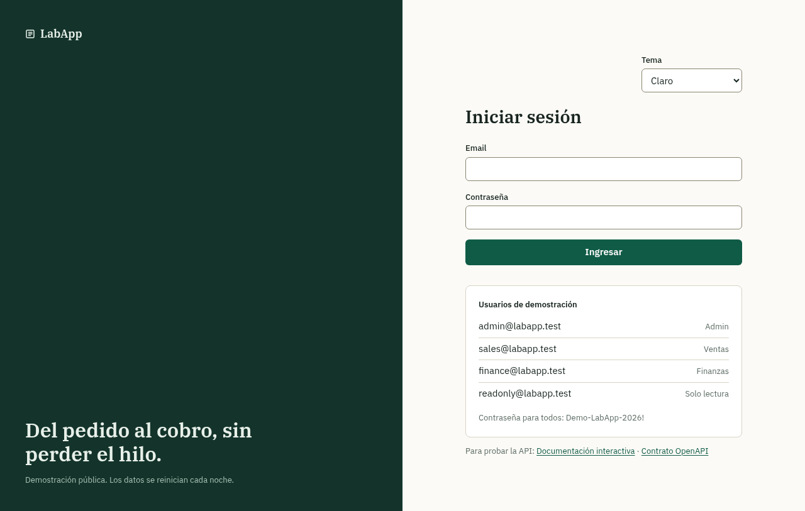
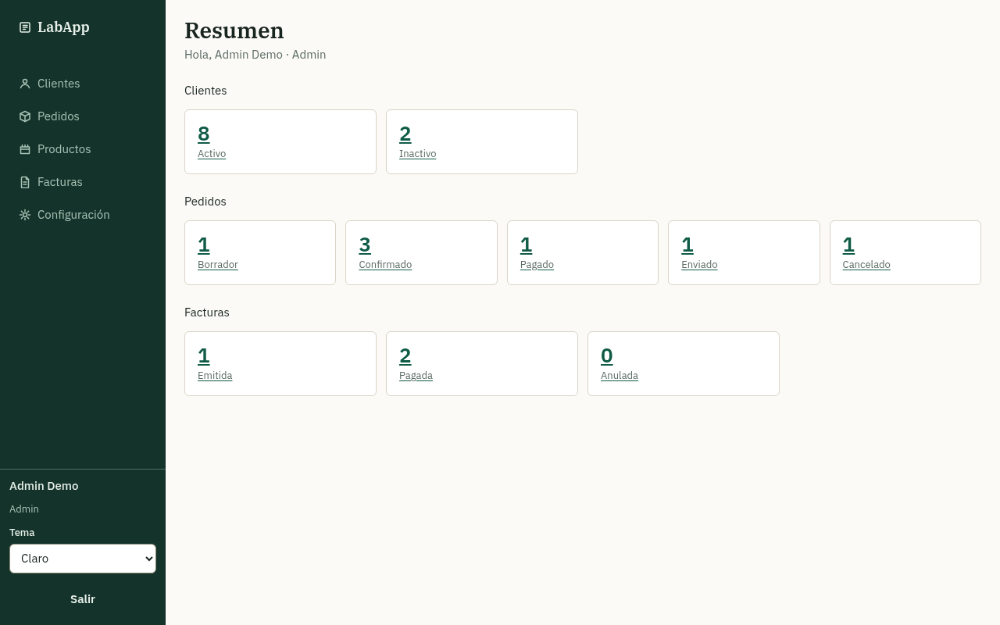
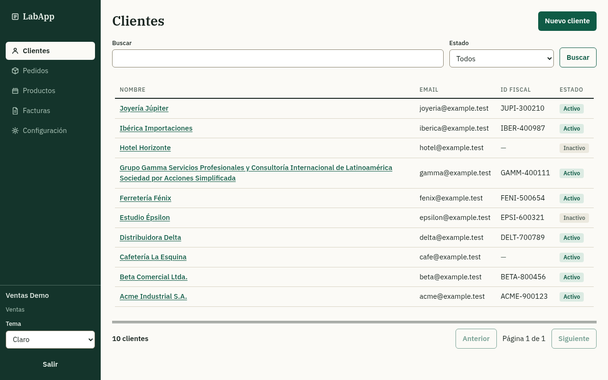
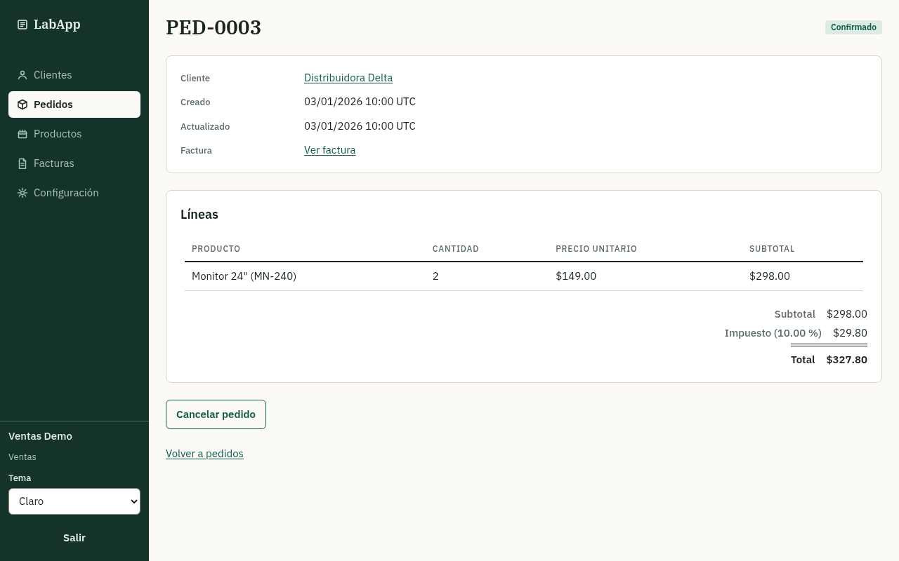
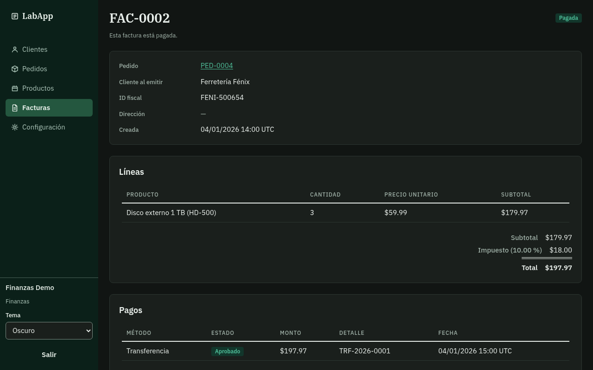
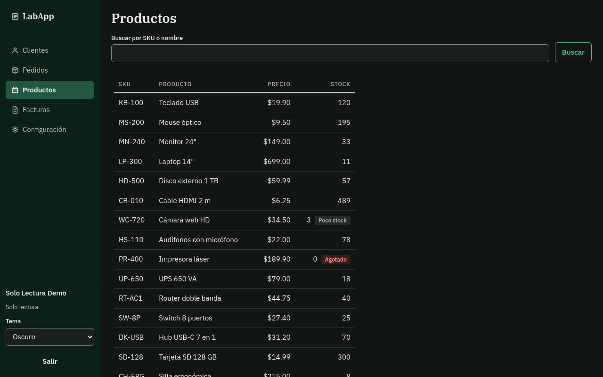
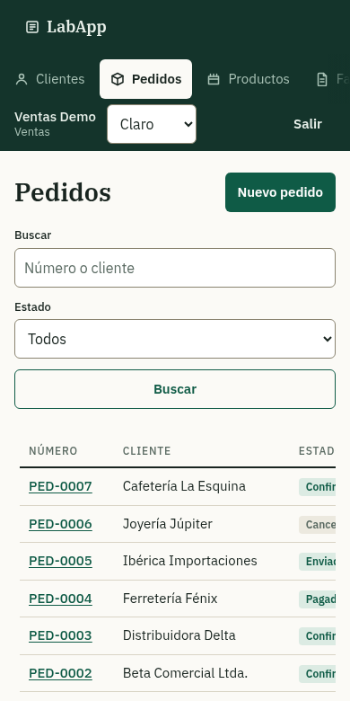

# LabApp

A small order-to-cash ERP (customers, orders, invoices, payments) built to be an ideal target for test automation: a stable `data-testid` on every interactive element, accessible markup, deterministic data, and test-only controls to reset data, move the clock and inject faults.

> Spanish version: [README.es.md](README.es.md)

**Status:** under active development, not deployed yet. What exists today is listed under "Where it stands"; the specification, the architecture and the testability contract are written and kept in sync with the code.

## Screenshots

Taken from a production build with the seed data, in the two voices of the "Libro mayor" design and at phone width.

<p>
  
  
  
  
  
  
</p>



## Why

Public demo apps for test automation often ship elements without reliable locators, which forces automation engineers into brittle selectors. LabApp is designed the other way around: testability is a contract (see [docs/TESTABILITY.md](docs/TESTABILITY.md)), enforced by types, lint rules and two audits that run in CI (a static one and a browser one with axe).

## What it does

Three core flows, polished before any new module is added:

1. Create a customer.
2. Build and confirm an order.
3. Invoice the order and register the payment.

Roles: Admin, Sales, Finance and Read-only. The screen language is Spanish. Business rules live in [docs/SPEC.md](docs/SPEC.md).

## Stack

| Layer | Choice |
|---|---|
| Backend | FastAPI (Python), SQLAlchemy 2, Alembic, PostgreSQL |
| Frontend | Next.js, TypeScript, Tailwind, TanStack Query and Table |
| Contract | OpenAPI generated by the backend, typed client generated for the frontend |
| Local | One start script (`mise run dev`), in-memory data or a Neon development database, fake payment gateway; the fake email is only written to the logs |
| Online demo | Vercel (web and API in one project), Neon (Postgres), all on free tiers |

## Where it stands

| Area | State |
|---|---|
| Login, sessions and the four roles | Done (in memory and in PostgreSQL) |
| Customers: API, screens, PostgreSQL store | Done |
| Orders: API, screens, PostgreSQL store with stock and numbering under concurrency | Done |
| Settings (tax rate, Admin only) and the home summary | Done |
| Design: "Libro mayor" theme in a light and a dark voice, selector remembered per browser | Done |
| Request guards: origin check, malformed JSON, body size, rate limits, lock timeouts | Done |
| Testability audits in CI: static test-id audit, browser audit (test ids and axe) in both themes, PostgreSQL integration tests | Done |
| Invoices and payments: API, screens, PostgreSQL store with idempotent payments and a fake gateway | Done |
| Test-only controls (reset, seed, clock, fault injection) with state in PostgreSQL, guarded by a token | Done |
| API contract: `docs/openapi.json`, checked against the code in CI | Done |
| Automation guide for the web UI, the API and the test controls, generated test id catalog | Done |
| First online deployment (Vercel and Neon) and the nightly data reset | Configured, not deployed yet |

## Roadmap

| Milestone | Content |
|---|---|
| M0 | Repository bootstrap, specification, architecture, CI skeleton |
| M1 | Shared foundation, login and roles, test-only controls, customers, first online deploy |
| M2 | Orders |
| M3 | Invoices and payments |
| M4 | Polish: 100% test-id coverage, accessibility, demo hardening |

## Demo users

The login screen shows the credentials of four seeded users, one per role: `admin@labapp.test`, `sales@labapp.test`, `finance@labapp.test` and `readonly@labapp.test`. In the online demo the data will be shared and reset every night.

## Repository layout

| Path | Purpose |
|---|---|
| `backend/` | FastAPI application and its internal tests |
| `frontend/` | Next.js application and its component tests |
| `tools/audit/` | Test-id and accessibility audits run in CI |
| `tests/` | Reserved for the owner's end-to-end and API automation suite |
| `docs/` | Specification, architecture, testability contract, deployment and development guides; the task briefs and the review record of every merged task |

## Getting started

```bash
mise install    # once: Node, pnpm and uv at the pinned versions
mise run dev    # API on 127.0.0.1:8000, web on localhost:3000, data in memory
```

Open <http://localhost:3000> and log in with one of the demo users. New to driving this app? [docs/AUTOMATION_GUIDE.md](docs/AUTOMATION_GUIDE.md) is a practical guide for test automation against the web UI, the HTTP API and the test controls, and [docs/PRACTICE.md](docs/PRACTICE.md) is its other half: a catalog of practice scenarios — what to test, row by row, with the exact expected result taken from the specification. See [docs/DEVELOPMENT.md](docs/DEVELOPMENT.md) for the database option and the other commands, and [docs/DEPLOYMENT.md](docs/DEPLOYMENT.md) for the online deployment.

## License

[MIT](LICENSE)
